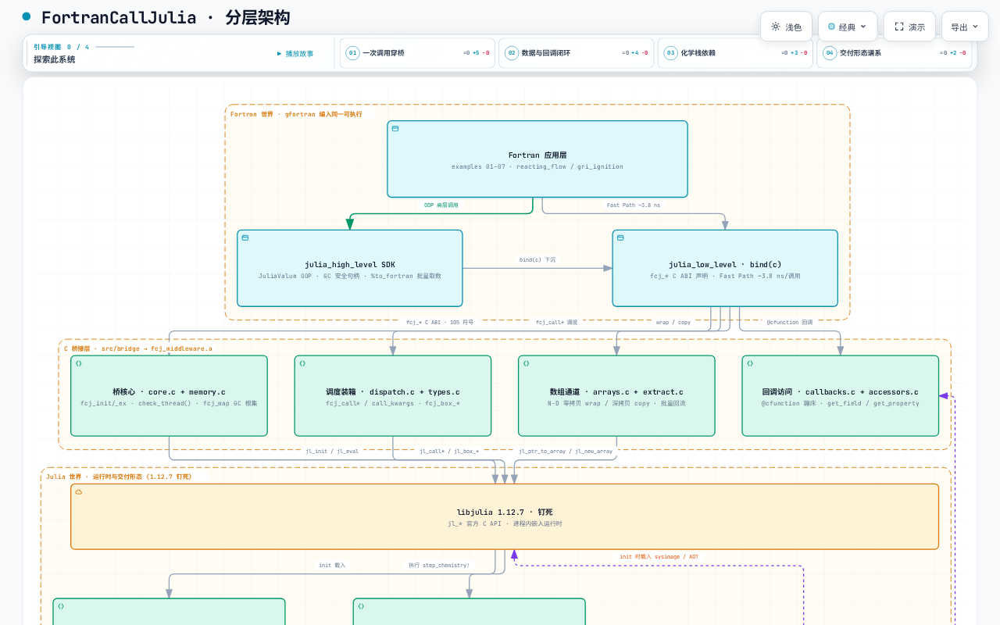

# Architecture

FortranCallJulia is three worlds in one process: a Fortran application, a C
bridge, and an embedded Julia runtime. The Fortran side never touches Julia
APIs directly; the Julia side never sees Fortran declarations. Everything
they exchange passes through the `fcj_*` C ABI. This page walks the layers
top to bottom, then shows the full system as an interactive diagram.

## The Fortran world

Everything here compiles into your executable with gfortran:

- **The application layer** -- examples 01 through 07, from a first
  `fcj_init` call up to the two capstone executables (`reacting_flow`,
  `gri_ignition`).
- **`julia_high_level`** -- the object-oriented SDK: `JuliaValue` handles
  with GC-safe lifetimes, field/property navigation (`%element`,
  `%property`), and batch extraction (`%to_fortran`) for pulling whole
  arrays back in one call.
- **`julia_low_level`** -- the `bind(c)` layer of `fcj_*` declarations for
  callers that want minimal abstraction. This is where the Fast Path lives:
  a raw function pointer costing ~3.8 ns per call, versus ~815 ns for the
  generic dispatch path.

## The C bridge

`src/bridge`, eight C source files built into `fcj_middleware.a`, roughly
105 exported `fcj_*` symbols. Four concerns, four module pairs:

| Module pair | Owns |
|---|---|
| `core.c` + `memory.c` | Lifecycle (`fcj_init` / `fcj_init_ex` / exit), thread checking (`check_thread()`), the GC root set (`fcj_map`) |
| `dispatch.c` + `types.c` | Generic calls (`fcj_call*`, keyword arguments) and boxing (`fcj_box_*`) for every scalar type |
| `arrays.c` + `extract.c` | N-dimensional zero-copy wraps and deep copies; batch flow of results back to Fortran |
| `callbacks.c` + `accessors.c` | `@cfunction` trampolines (Julia calling Fortran) and field/property access into live objects |

## The Julia world

- **`libjulia` 1.12.7, pinned.** The official `jl_*` C API, embedded
  in-process. The pin is load-bearing: comparison baselines must run the
  same Julia version the bridge embeds, or residuals are meaningless.
- **`FortranBridge.jl`** -- five modules (GCManager, FunctionRegistry,
  Accessors, Callbacks, Utilities) implementing the Julia side of the ABI.
- **`FjKinetics.jl` v0.2** -- `AbstractKineticsSolver` with `OneStepSolver`
  (OrdinaryDiffEq, FBDF / Rodas5P) and `GriSolver` front ends.
- **The SciML stack, compat-pinned** -- Catalyst 16, OrdinaryDiffEq 6,
  SciMLBase 2. Pinned because unpinned drift between these packages
  silently degrades performance and reproducibility.
- **`ChemMechSim.jl`** -- mechanism input; supplies GRI-Mech 3.0 with
  53 species and 325 reactions. Open source; the validation here used
  v1.2.0.

## The path of one call

A forward call walks four hops, with the exception flag checked after each:

```text
Fortran bind(c) caller
  -> fcj_* entry (dispatch, boxing, root-set bookkeeping)
     -> jl_call* / jl_box_* (libjulia C API)
        -> Julia method (FortranBridge.jl or user code)
```

The reverse direction is symmetric: `julia_callback` wraps a Fortran
subroutine in an `@cfunction` trampoline, so an OrdinaryDiffEq solver can
call a Fortran right-hand side on every step. If any hop fails, the call
returns an error code and `get_last_error_message()` carries the Julia error
text back to the caller.

Delivery forms stack on top of this unchanged: the same calls run JIT
(17.3 s cold start), against a sysimage (1.90 s), or AOT-compiled (first
call ~12 μs) -- see [Deployment modes](../user/deployment-modes.md).

## The full system, interactively

<a href="/assets/fcj-architecture.html" target="_blank">Open the full version
in a new tab</a> -- it supports search, path tracing between two nodes, and
a guided tour.

<figure>
  <iframe src="/assets/fcj-architecture.html"
          title="FortranCallJulia architecture diagram (interactive)"
          loading="lazy"
          style="width:100%;height:900px;border:1px solid #ccc;">
  </iframe>
</figure>

If the embedded frame is unavailable (no JavaScript, restricted network),
the static preview below carries the same layer structure:



Reading the diagram: the three columns are the three worlds above; edges
crossing columns are the `fcj_*` ABI and the `@cfunction` callback path.
The next page pins the whole construction to numbers:
[Validation](validation.md).
