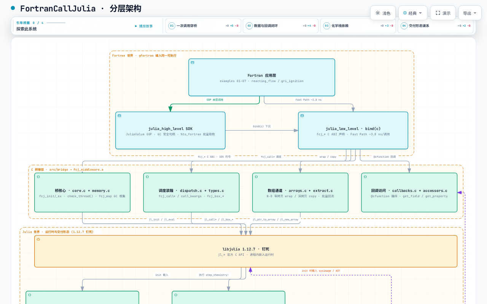

# 架构

FortranCallJulia 是同一进程里的三个世界：Fortran 应用、C 桥、被嵌入的 Julia 运行时。Fortran 侧从不直接触碰 Julia API；Julia 侧也看不到任何 Fortran 声明。二者交换的一切都经由 `fcj_*` C ABI 通过。本页自上而下过一遍各层，然后给出整个系统的交互式架构图。

## Fortran 世界

这里的一切都随你的可执行文件由 gfortran 编入：

- **应用层**——示例 01 至 07，从第一次 `fcj_init` 调用一直到两个收官可执行文件（`reacting_flow`、`gri_ignition`）。
- **`julia_high_level`**——面向对象的 SDK：带 GC 安全生命周期的 `JuliaValue` 句柄、字段/属性导航（`%element`、`%property`）、批量取数（`%to_fortran`，一次调用取回整个数组）。
- **`julia_low_level`**——`fcj_*` 声明的 `bind(c)` 层，面向想要最少抽象的调用方。Fast Path 就在这里：裸函数指针，每次调用约 3.8 ns，而泛型分发路径约 815 ns。

## C 桥接层

`src/bridge`，8 个 C 源文件编成 `fcj_middleware.a`，导出约 105 个 `fcj_*` 符号。四类职责，四个模块对：

| 模块对 | 职责 |
|---|---|
| `core.c` + `memory.c` | 生命周期（`fcj_init` / `fcj_init_ex` / 退出）、线程检查（`check_thread()`）、GC 根集（`fcj_map`） |
| `dispatch.c` + `types.c` | 泛型调用（`fcj_call*`、关键字参数）与全类型标量装箱（`fcj_box_*`） |
| `arrays.c` + `extract.c` | N 维零拷贝 wrap 与深拷贝 copy；结果批量回流 Fortran |
| `callbacks.c` + `accessors.c` | `@cfunction` 蹦床（Julia 调 Fortran）与对活动对象的字段/属性访问 |

## Julia 世界

- **`libjulia` 1.12.7，钉死。** 官方 `jl_*` C API，进程内嵌入。版本钉死并非例行公事：对拍基线必须与桥内嵌的 Julia 同版本，否则残差毫无意义。
- **`FortranBridge.jl`**——五个模块（GCManager、FunctionRegistry、Accessors、Callbacks、Utilities），实现 ABI 的 Julia 侧。
- **`FjKinetics.jl` v0.2**——`AbstractKineticsSolver`，提供 `OneStepSolver`（OrdinaryDiffEq，FBDF / Rodas5P）与 `GriSolver` 两种前端。
- **SciML 栈，compat 钉死**——Catalyst 16、OrdinaryDiffEq 6、SciMLBase 2。钉死的原因：这些包之间无约束的版本漂移会悄悄损害性能与可复现性。
- **`ChemMechSim.jl`**——机理输入；提供 GRI-Mech 3.0，53 物种 / 325 反应。已开源；本文验证使用 v1.2.0。

## 一次调用的路径

前向调用走四跳，每一跳之后都检查异常标志：

```text
Fortran bind(c) 调用方
  -> fcj_* 入口（分发、装箱、根集记账）
     -> jl_call* / jl_box_*（libjulia C API）
        -> Julia 方法（FortranBridge.jl 或用户代码）
```

反方向对称：`julia_callback` 把 Fortran 子程序包进 `@cfunction` 蹦床，OrdinaryDiffEq 求解器便能在每一步调用 Fortran 右端项。任何一跳失败，调用返回错误码，`get_last_error_message()` 把 Julia 错误文本带回调用方。

交付形态原样叠加在这条路径之上：同样的调用可按 JIT（冷启动 17.3 s）、sysimage（1.90 s）或 AOT（首次调用约 12 μs）运行，见[交付形态](../user/deployment-modes.md)。

## 交互式全景图

<a href="../../../assets/fcj-architecture.html" target="_blank">在新标签页打开完整版</a>——支持搜索、两点间路径追踪和引导式浏览。

<figure>
  <iframe src="../../../assets/fcj-architecture.html"
          title="FortranCallJulia 架构图（交互式）"
          loading="lazy"
          style="width:100%;height:900px;border:1px solid #ccc;">
  </iframe>
</figure>

若内嵌框架不可用（禁用 JavaScript、受限网络），下面的静态预览承载同样的分层结构：



读图要领：三列即上述三个世界；跨列的边就是 `fcj_*` ABI 与 `@cfunction` 回调路径。下一页把整套构造钉在数字上：[验证](validation.md)。
